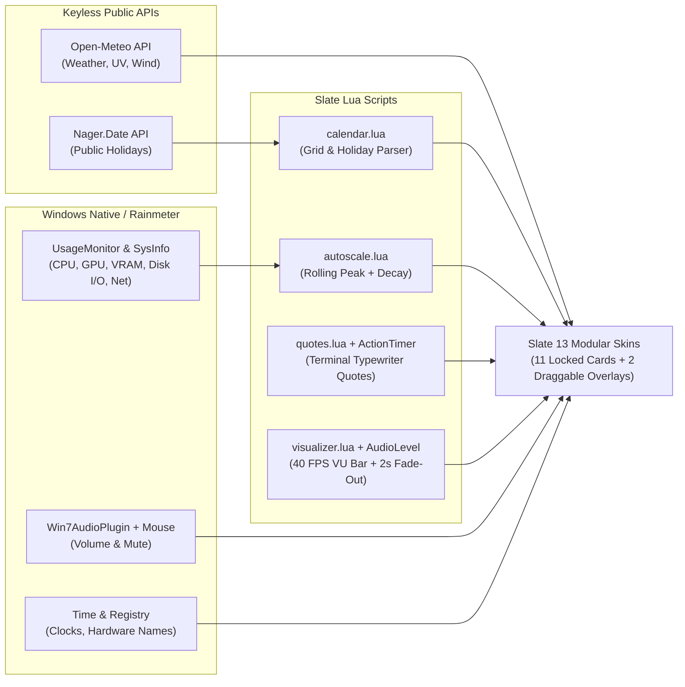

# Slate — Autonomous Retro-Futuristic Rainmeter Suite

**Slate** is a lightweight, self-contained **Rainmeter 4.5+** desktop widget suite designed with a retro-futuristic **Cyber-Sage** aesthetic, frosted acrylic glass cards, scrolling micro-grid telemetry charts, and zero dependency on external hardware monitoring services (no HWiNFO, AIDA64, CoreTemp, or heavy third-party frameworks required).

---

## Highlights

- **100% Autonomous Telemetry**: Uses native Rainmeter measures and Windows Performance Counters (`UsageMonitor`) for CPU, RAM, GPU, VRAM, Disk Space, Disk Active Time + Read/Write throughput, and Network Upload/Download.
- **Dynamic Auto-Scaling Charts**: Custom Lua rolling-peak scaler (`autoscale.lua`) with exponential decay keeps history graphs legible even at low/idle loads while adapting smoothly to traffic and load spikes.
- **High-FPS VU Meter Bar with Auto Fade-Out**: 40 FPS draggable spectrum visualizer (`Visualizer`) with peak-hold indicators, right-click column presets (`16 / 24 / 32 / 48 / 64`), smooth fade-out after 2 seconds of silence, automatic idle sleep (`~0%` CPU when silent), and automatic rebind when the default audio output device changes (speaker / headset / USB) via `Win7AudioPlugin`.
- **Keyless Public APIs**:
  - **Weather & Details** powered by [Open-Meteo](https://open-meteo.com/) (no API key needed).
  - **Public Holidays Calendar** powered by [Nager.Date](https://date.nager.at/) (no API key needed) with built-in offline fallback.
- **Interactive Audio Control**: Drag-and-scroll volume slider with mute toggle and dynamic hover knob via `Win7AudioPlugin` + `Mouse.dll`.
- **Frosted Acrylic Blur**: Native Windows 10/11 blur with rounded corners via `FrostedGlass.dll`.

---

## Included Widgets (15 Skins · 2 Frameless Overlays + 13 Modular Cards)

| Desktop Overlays (Frameless & Draggable) | Size | Description |
| :--- | :---: | :--- |
| **`DesktopClock`** | `760×240` | Large 92pt frameless digital clock, uppercase date bar, and rotating sci-fi/geek quotes (`@Resources/Data/quotes.txt`) with a 25ms terminal typewriter animation (`ActionTimer.dll`), 1-minute auto-rotation, and click-to-skip. |
| **`Visualizer`** | `Dynamic` | High-FPS (`40 FPS`) draggable VU meter spectrum bar with peak-hold indicators, right-click column presets (`16 / 24 / 32 / 48 / 64`), smooth fade-out after 2s of silence, and automatic idle sleep. |

| Column 1 (Time, Weather, Astronomy & Calendar) | Size | Description |
| :--- | :---: | :--- |
| **`Clock`** | `256×128` (`4x2`) | Local 24h clock, automatic `CET / CEST · UTC` offset badge, and full date. |
| **`WorldClock`** | `256×64` (`4x1`) | Secondary timezone card (defaults to `Sao Paulo · BRT · UTC-3`). |
| **`Weather`** | `256×128` (`4x2`) | Hero weather card: condition badge, 56px weather icon, current temperature, `FL` (feels like), and a visual `MIN / MAX` thermal range bar. |
| **`WeatherDetails`** | `256×64` (`4x1`) | 3-column atmospheric telemetry: `WIND` (with dynamic 8-way direction arrow), `HUMIDITY`, and `UV INDEX`. |
| **`SunMoon`** | `256×64` (`4x1`) | Real astronomical moon phase icon (`8` phases), lunar phase name + `% illuminated`, and local `Sunrise ↑` / `Sunset ↓` times. |
| **`Calendar`** | `256×264` (`4x4`) | Interactive monthly calendar (month navigation via arrows or mouse wheel), today pill highlight, and automatic Spain / Aragón public holiday highlights + tooltips. |

| Column 2 (System, Storage, Network, Media & Audio) | Size | Description |
| :--- | :---: | :--- |
| **`CPU`** | `256×128` (`4x2`) | Processor model auto-detection, utilization %, clock speed (GHz), and scrolling micro-grid graph. |
| **`RAM`** | `256×64` (`4x1`) | Used / Total GB, utilization %, and thin progress bar. |
| **`GPU`** | `256×128` (`4x2`) | GPU model auto-detection, core utilization %, dedicated VRAM usage (GB), and scrolling micro-grid graph. |
| **`Disk`** | `256×128` (`4x2`) | `Disk C:` used/total GB + progress bar, global Read/Write throughput (`_Total`), and scrolling Disk Active Time (`%`) graph. |
| **`Network`** | `256×128` (`4x2`) | Active adapter alias, connectivity status, live Up/Down rates, and dual side-by-side Upload / Download history graphs. |
| **`Media`** | `256×64` (`4x1`) | Now Playing media controller (`WindowsNowPlaying.dll`: Track, Artist, Prev/Play-Pause/Next, progress bar) that transitions cleanly to a `System Uptime · STANDBY` telemetry view when no media is active. |
| **`Volume`** | `256×64` (`4x1`) | Master volume slider (click/drag track, scroll wheel ±2%, click icon or percentage to mute). |

---

## Architecture & Data Flow



---

## Requirements

1. **[Rainmeter 4.5+](https://www.rainmeter.net/)** on Windows 10 or Windows 11.
2. **Fonts** (static TTF installed in `C:\Windows\Fonts`):
   - [Oxanium](https://fonts.google.com/specimen/Oxanium) (`Oxanium`, `Oxanium Medium`, `Oxanium SemiBold`) — geometric sci-fi display/UI font.
   - [Geist Mono](https://vercel.com/font) (`Geist Mono Medium`) — monospaced telemetry and numeric readouts.
3. **Rainmeter Plugins** (standard / bundled in modern Rainmeter setups):
   - `UsageMonitor.dll`, `SysInfo.dll`, `WebParser.dll`, `Win7AudioPlugin.dll`, `AudioLevel.dll`, `Mouse.dll`, `ActionTimer.dll`, `FrostedGlass.dll`.

---

## Installation & Deployment

1. Clone this repository:
   ```powershell
   git clone https://github.com/marcelofrau/slate-rainmeter.git
   cd slate-rainmeter
   ```
2. Run the deployment script in PowerShell:
   ```powershell
   powershell -ExecutionPolicy Bypass -File .\deploy.ps1
   ```
   `deploy.ps1` automatically detects your configured `SkinPath` from `%APPDATA%\Rainmeter\Rainmeter.ini`, mirrors `Slate/`, converts `.ini` and `.inc` files to **UTF-16 LE** (required by Rainmeter for proper Unicode rendering), refreshes Rainmeter, and activates + positions all 11 cards in a clean two-column layout.

---

## Customization

All user-tunable settings live in a single file: **`Slate/@Resources/variables.inc`**:

- **Weather Location**: Set `Latitude`, `Longitude`, `LocationName`, and `UnitTemp` (`C` or `F`).
- **World Clock**: Set `WorldCity` and `WorldTZ` (UTC offset, e.g. `-3`).
- **GPU Total VRAM**: Set `GPUTotalMB` (in MB, e.g. `12282` for 12 GB GPUs).
- **Color Palette & Fonts**: Adjust `AccentColor`, `CardColor`, `TextPrimary`, or font family names in one place and run `.\deploy.ps1 -NoActivate` to apply.

---

## License

This project is licensed under the **GNU General Public License v3.0 (GPL-3.0)** — see the [LICENSE](LICENSE) file for details.
Weather and monochrome icon assets are adapted from [QuantoFlx](https://github.com/stevehsudrawing/quantoflx) by Steve Hsu (CC BY-NC-SA 4.0).
