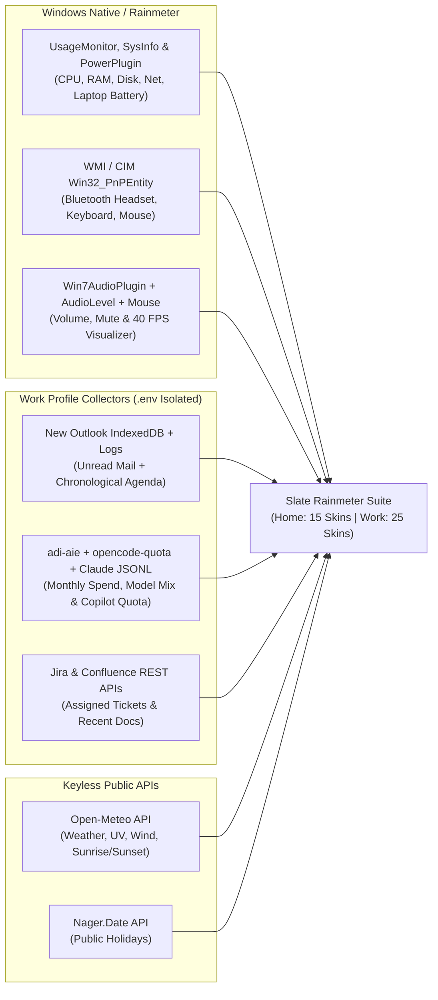

# Slate — Autonomous Retro-Futuristic Rainmeter Suite

**Slate** is a lightweight, self-contained **Rainmeter 4.5+** desktop widget suite designed with a retro-futuristic **Cyber-Sage** aesthetic, frosted acrylic glass cards, scrolling micro-grid telemetry charts, and zero dependency on heavy background hardware monitoring services (no HWiNFO, AIDA64, or CoreTemp required).

It supports two built-in deployment profiles from a single codebase:
- **`Home` (Default — Single Monitor)**: 2 frameless desktop overlays + 13 locked telemetry cards arranged in a two-column layout.
- **`Work` (Dual Monitor — Primary + Laptop Display)**: keeps the full `Home` suite on your main monitor and adds a 3-column, 10-card productivity, AI telemetry, and engineering hub on your secondary/laptop screen.

---

## Highlights

- **100% Autonomous System Telemetry**: Uses native Rainmeter measures and Windows Performance Counters (`UsageMonitor`) for CPU, RAM, Disk Space, Disk Active Time + Read/Write throughput, and Network Upload/Download. The GPU card reads NVIDIA GPUs directly via `nvidia-smi`.
- **Dual-Profile Multi-Monitor Architecture**: `deploy.ps1` preserves your `Home` coordinates and layout by default, while `-ProfileName Work` automatically detects your secondary display's `WorkingArea` and centers a 3-column workstation grid (`792px` tall) saved to an isolated `Slate_Work` Rainmeter layout.
- **Zero-Secret Git Hygiene**: Corporate endpoints (`JIRA_URL`, `CONFLUENCE_URL`, `FINOPS_DASHBOARD_URL`) and personal tokens (`JIRA_PERSONAL_TOKEN`, `CONFLUENCE_PERSONAL_TOKEN`) are loaded from environment variables or a git-ignored `.env` file (`%APPDATA%\Rainmeter\SlateWork\.env`). Quick Notes and telemetry caches live in `%APPDATA%\Rainmeter\SlateWork`, never inside the repository.
- **High-Speed Background Collectors**:
  - **New Outlook (`olk.exe`) Calendar & Inbox Parser**: Pure-Python Snappy/LevelDB reader with raw-byte pre-filtering (`~3s`) extracts your real-time Inbox unread count and chronological remaining meetings of the day.
  - **Fast CIM Bluetooth Telemetry**: Queries active Headset, Keyboard, and Mouse battery percentages in a single WMI/CIM pass (`~0.55s`).
  - **AI Spend & Quota Tracking**: Reads Claude monthly/daily spend (`adi-aie`), local per-model token share (`Opus / Sonnet / Haiku`), and GitHub Copilot Premium Interactions quota (`@slkiser/opencode-quota`).
- **Dynamic Auto-Scaling Charts & 40 FPS Visualizer**: Custom Lua rolling-peak scaler (`autoscale.lua`) with exponential decay, plus a 40 FPS VU spectrum bar (`Visualizer`) with peak-hold, 2s silence fade-out, and automatic audio device rebind.

---

## Included Widgets (25 Skins · 2 Overlays + 13 Home Cards + 10 Work-Only Cards)

### Desktop Overlays (Frameless & Draggable)

| Skin | Size | Description |
| :--- | :---: | :--- |
| **`DesktopClock`** | `760×240` | Large 92pt frameless digital clock, uppercase date bar, and rotating sci-fi/geek quotes (`@Resources/Data/quotes.txt`) with a 25ms terminal typewriter animation (`ActionTimer.dll`), 1-minute auto-rotation, and click-to-skip. |
| **`Visualizer`** | `Dynamic` | High-FPS (`40 FPS`) draggable VU meter spectrum bar with peak-hold indicators, right-click column presets (`16 / 24 / 32 / 48 / 64`), smooth fade-out after 2s of silence, and automatic idle sleep. |

### Home Profile — Column 1 (Time, Weather, Astronomy & Calendar)

| Skin | Size | Description |
| :--- | :---: | :--- |
| **`Clock`** | `256×128` (`4x2`) | Local 24h clock, automatic `CET / CEST · UTC` offset badge, and full date. |
| **`WorldClock`** | `256×64` (`4x1`) | Secondary timezone card (defaults to `Sao Paulo · BRT · UTC-3`). |
| **`Weather`** | `256×128` (`4x2`) | Hero weather card: condition badge, 56px weather icon, current temperature, `FL` (feels like), and a visual `MIN / MAX` thermal range bar. |
| **`WeatherDetails`** | `256×64` (`4x1`) | 3-column atmospheric telemetry: `WIND` (with dynamic 8-way direction arrow), `HUMIDITY`, and `UV INDEX`. |
| **`SunMoon`** | `256×64` (`4x1`) | Illustrated vector moon phase icon (`8` phases), lunar phase name + `% illuminated`, and visual solar horizon trajectory arc (`Sunrise → Sunset`). |
| **`Calendar`** | `256×264` (`4x4`) | Interactive monthly calendar (month navigation via arrows or mouse wheel), today pill highlight, and automatic Spain / Aragón public holiday highlights + tooltips. |

### Home Profile — Column 2 (System, Storage, Network, Media & Audio)

| Skin | Size | Description |
| :--- | :---: | :--- |
| **`CPU`** | `256×128` (`4x2`) | Processor model auto-detection, utilization %, clock speed (GHz), and scrolling micro-grid graph. |
| **`RAM`** | `256×64` (`4x1`) | Used / Total GB, utilization %, and thin progress bar. |
| **`GPU`** | `256×128` (`4x2`) | NVIDIA GPU model auto-detection, core utilization %, dedicated VRAM usage (GB), and scrolling micro-grid graph. |
| **`Disk`** | `256×128` (`4x2`) | `Disk C:` used/total GB + progress bar, global Read/Write throughput (`_Total`), and scrolling Disk Active Time (`%`) graph. |
| **`Network`** | `256×128` (`4x2`) | Active adapter alias, connectivity status, live Up/Down rates, and dual side-by-side Upload / Download history graphs. |
| **`Media`** | `256×64` (`4x1`) | Now Playing media controller (`WindowsNowPlaying.dll`: Track, Artist, Prev/Play-Pause/Next, progress bar) that transitions cleanly to a `System Uptime · STANDBY` telemetry view when no media is active. |
| **`Volume`** | `256×64` (`4x1`) | Master volume slider (click/drag track, scroll wheel ±2%, click icon or percentage to mute). |

---

### Work Profile — 3-Column Secondary Monitor Suite (`-ProfileName Work`)

Activated only when deploying with `-ProfileName Work`. All three columns are `256px` wide with an `8px` gap and align to an exact `792px` vertical stack:

| Column | Skin | Size | Refresh | Description |
| :---: | :--- | :---: | :---: | :--- |
| **Col 1** | **`Work\Comms`** | `256×320` (`4x5`) | `5 min` + Reload icon | **Outlook**: real-time Inbox unread mail counter (`X new mail`) + 8-slot chronological agenda of remaining meetings for today and tomorrow. |
| **Col 1** | **`Work\Bluetooth`** | `256×64` (`4x1`) | `1 min` + Click icon | **Bluetooth Peripherals**: compact 3-column battery gauge for active **Headset**, **Keyboard**, and **Mouse** with vector icons and device name tooltips. |
| **Col 1** | **`Work\Jira`** | `256×192` (`4x3`) | `5 min` + Reload icon | **Jira Tickets**: unresolved issues assigned to you (`Key · Summary · Status`), clickable to open directly in your browser. |
| **Col 1** | **`Work\Confluence`** | `256×192` (`4x3`) | `5 min` + Reload icon | **Confluence Docs**: 5 most recently created/contributed pages with space badges and direct browser links. |
| **Col 2** | **`Work\ClaudeCost`** | `256×128` (`4x2`) | `15 min` + Reload icon | **Claude Spend**: monthly & daily spend via `adi-aie` + local current-month token cost distribution bar (`Opus / Sonnet / Haiku`). |
| **Col 2** | **`Work\CopilotQuota`** | `256×128` (`4x2`) | `15 min` + Reload icon | **Copilot Quota**: remaining % and count of GitHub Copilot Premium Interactions, 10-cell segmented gauge, and reset countdown in days. |
| **Col 2** | **`Work\AIModels`** | `256×520` (`4x8`) | Static (`0%` CPU) | **AI Model Matrix**: 17-model visual cheat sheet across Claude Lakehouse, OpenAI GPT-6 / 5.6, Google Gemini 4, and Copilot Picker with `$In/$Out` per MTok and 2-word usage hints. |
| **Col 3** | **`Work\Battery`** | `256×128` (`4x2`) | `2 sec` | **Laptop Battery**: 10-cell segmented luminous charge bar, AC/Battery badge, remaining time, and scrolling micro-grid history chart. |
| **Col 3** | **`Work\Focus`** | `256×128` (`4x2`) | `1 sec` | **Focus Timer**: countdown timer with clickable `5m / 10m / 15m / 20m / 25m / 30m` presets, mouse-wheel duration step, and bottom progress bar. |
| **Col 3** | **`Work\Stopwatch`** | `256×128` (`4x2`) | `50 ms` (run) / `1s` (idle) | **Stopwatch**: centisecond (`MM:SS.CC`) progressive stopwatch with `START/PAUSE`, `MARK LAP` display, and automatic idle throttling. |
| **Col 3** | **`Work\Notes`** | `256×384` (`4x6`) | `5 sec` | **Quick Notes**: 18-line local scratchpad preserving blank-line spacing; opens in `Notepad3` on click and stores data outside Git in `%APPDATA%\Rainmeter\SlateWork\work-notes.txt`. |

---

## Architecture & Data Flow



---

## Requirements

1. **[Rainmeter 4.5+](https://www.rainmeter.net/)** on Windows 10 or Windows 11.
2. **Fonts** (static TTF installed in `C:\Windows\Fonts`):
   - [Oxanium](https://fonts.google.com/specimen/Oxanium) (`Oxanium`, `Oxanium Medium`, `Oxanium SemiBold`) — geometric sci-fi display/UI font.
   - [Geist Mono](https://vercel.com/font) (`Geist Mono Medium`) — monospaced telemetry and numeric readouts.
3. **Rainmeter Plugins** (bundled with standard Rainmeter installs):
   - `UsageMonitor.dll`, `SysInfo.dll`, `WebParser.dll`, `PowerPlugin.dll`, `RunCommand.dll`, `Win7AudioPlugin.dll`, `AudioLevel.dll`, `Mouse.dll`, `ActionTimer.dll`, `FrostedGlass.dll`, `WindowsNowPlaying.dll`.
4. **Optional (Work Profile)**:
   - PowerShell 7 (`pwsh`) and Python 3 (`python`) on `PATH`.
   - `.env` file (copied from `.env.example`) for Jira, Confluence, and FinOps URLs/tokens.

---

## Installation & Deployment

1. Clone this repository:
   ```powershell
   git clone https://github.com/marcelofrau/slate-rainmeter.git
   cd slate-rainmeter
   ```

2. **Deploy the `Home` profile (default — single monitor)**:
   ```powershell
   pwsh -NoProfile -File .\deploy.ps1
   ```

3. **Deploy the `Work` profile (dual monitor — keeps `Home` on primary + adds 3 columns on secondary monitor)**:
   ```powershell
   # Optional: copy .env.example to .env and configure your work URLs/tokens
   Copy-Item .env.example .env

   # List monitors to verify indices (optional)
   pwsh -NoProfile -File .\deploy.ps1 -ListMonitors

   # Deploy Work profile (auto-detects secondary display or accepts -WorkMonitorIndex N)
   pwsh -NoProfile -File .\deploy.ps1 -ProfileName Work
   ```

4. **Refresh skin files only (without moving or restarting skins)**:
   ```powershell
   pwsh -NoProfile -File .\deploy.ps1 -NoActivate
   ```

---

## Customization & Security

- **User Variables (`Slate/@Resources/variables.inc`)**: Configure `Latitude`, `Longitude`, `LocationName`, `UnitTemp`, `WorldCity`, `WorldTZ`, `GPUTotalMB`, `Visualizer` bands, and the Cyber-Sage color palette in one place.
- **Work Secrets & Endpoints (`.env`)**: Never hardcode corporate URLs or tokens in `.ini` or `.ps1` files. Place `JIRA_URL`, `JIRA_PERSONAL_TOKEN`, `CONFLUENCE_URL`, `CONFLUENCE_PERSONAL_TOKEN`, and `FINOPS_DASHBOARD_URL` in `.env` (git-ignored) or in your Windows user environment variables.

---

## License

This project is licensed under the **GNU General Public License v3.0 (GPL-3.0)** — see the [LICENSE](LICENSE) file for details.

Weather and monochrome icon assets are adapted from [QuantoFlx](https://github.com/stevehsudrawing/quantoflx) by Steve Hsu (CC BY-NC-SA 4.0).
