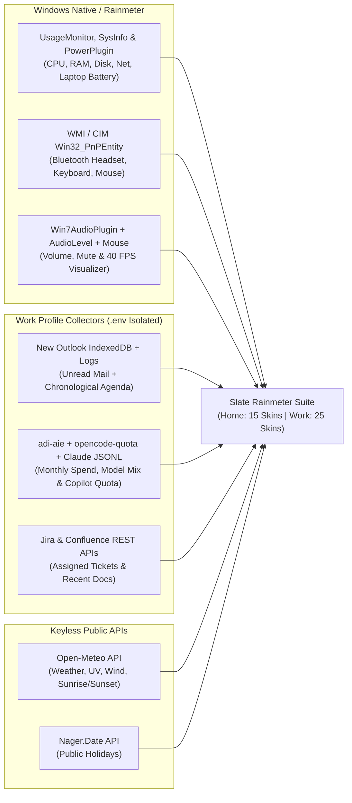

<div align="center">

# ◈ SLATE
### Autonomous Retro-Futuristic Rainmeter Telemetry & Productivity Suite

[](https://www.rainmeter.net/)
[](https://www.microsoft.com/windows)
[](https://www.lua.org/)
[](https://github.com/PowerShell/PowerShell)
[](https://www.python.org/)
[](LICENSE)

<br />


%20%7C%20Work%20(Dual--Screen)-1A1C22?style=flat-square&labelColor=1A1C22&color=6EB9AC)
-1A1C22?style=flat-square&labelColor=1A1C22&color=6EB9AC)

<p align="center">
  <b>Slate</b> is a self-contained <b>Rainmeter 4.5+</b> desktop suite crafted with a retro-futuristic <b>Cyber-Sage</b> aesthetic, frosted acrylic glass cards (<code>FrostedGlass.dll</code>), scrolling micro-grid telemetry charts, and a dual-profile multi-monitor engine that scales from a clean single-monitor gaming/home setup to a 3-column engineering & AI command center.
</p>

[Highlights](#-highlights) · [Profiles & Layout](#-profiles--multi-monitor-layout) · [Widget Catalog](#-widget-catalog-25-skins) · [Architecture](#-architecture--data-flow) · [Quick Start](#-quick-start) · [Configuration](#-configuration--security)

</div>

---

## ✨ Highlights

| Feature | What It Does |
| :--- | :--- |
| **100% Autonomous Telemetry** | Reads CPU, RAM, Disk Space, Disk Active Time + Read/Write throughput, and Network Up/Down via native Windows Performance Counters (`UsageMonitor`), plus NVIDIA GPU utilization and VRAM directly via `nvidia-smi`. |
| **Dual-Profile Multi-Monitor Engine** | Single `deploy.ps1` script supports **`Home`** (default single-screen layout) and **`Work`** (keeps `Home` on your primary 2K/4K monitor and centers a 3-column, 10-card workstation grid on your secondary/laptop display). |
| **AI Spend, Quota & Model Matrix** | Tracks real-time **Claude Code** monthly/daily spend, local per-model token share (`Opus / Sonnet / Haiku`), **GitHub Copilot** Premium Interactions remaining quota, and a 17-model `$In/$Out` reference sheet. |
| **Sub-Second & Pre-Filtered Collectors** | Pure-Python Snappy/LevelDB reader (`~2.8s`) extracts real-time **New Outlook (`olk.exe`)** unread mail and chronological remaining meetings; single-pass WMI/CIM query (`~0.8s`) reads **Bluetooth Headset, Keyboard & Mouse** batteries. |
| **Dynamic Auto-Scaling Charts** | Custom Lua rolling-peak scaler (`autoscale.lua`) with exponential decay keeps history graphs legible at idle loads while adapting smoothly to traffic and compute spikes. |
| **40 FPS VU Visualizer + Idle Sleep** | Draggable spectrum bar (`Visualizer`) with peak-hold indicators, right-click column presets (`16 / 24 / 32 / 48 / 64`), smooth fade-out after 2s of silence, `~0%` CPU idle sleep, and automatic audio output rebind. |
| **Zero-Secret Git Hygiene** | Corporate URLs, tokens, local notes, and runtime caches live in `.env` and `%APPDATA%\Rainmeter\SlateWork` — never inside the Git repository. |

---

## 🖥️ Profiles & Multi-Monitor Layout

```text
┌────────────────────────────────────────────────────────┐   ┌──────────────────────────────────────────┐
│              PRIMARY MONITOR (Home + Work)             │   │     SECONDARY / LAPTOP MONITOR (Work)    │
│                                                        │   │                                          │
│                                 ┌─────────┐ ┌─────────┐│   │       ┌─────────┐ ┌─────────┐ ┌─────────┐│
│                                 │  Clock  │ │   CPU   ││   │       │         │ │ Claude  │ │ Battery ││
│                                 ├─────────┤ ├─────────┤│   │       │ Outlook │ │  Spend  │ ├─────────┤│
│                                 │WorldClk │ │   RAM   ││   │       │ Agenda  │ ├─────────┤ │  Focus  ││
│                                 ├─────────┤ ├─────────┤│   │       │ (4x5)   │ │ Copilot │ │  Timer  ││
│                                 │ Weather │ │   GPU   ││   │       │         │ │  Quota  │ ├─────────┤│
│                                 ├─────────┤ ├─────────┤│   │       ├─────────┤ ├─────────┤ │Stopwatch││
│  ┌───────────────────────────┐  │W.Details│ │  Disk   ││   │       │BT Periph│ │         │ ├─────────┤│
│  │       DesktopClock        │  ├─────────┤ ├─────────┤│   │       ├─────────┤ │   AI    │ │         ││
│  │     09:42 · Sci-Fi Quote  │  │ SunMoon │ │ Network ││   │       │  Jira   │ │  Model  │ │  Quick  ││
│  ├───────────────────────────┤  ├─────────┤ ├─────────┤│   │       │ Tickets │ │ Matrix  │ │  Notes  ││
│  │  ▂▄▆█ Visualizer █▆▄▂     │  │Calendar │ │  Media  ││   │       ├─────────┤ │  (4x8)  │ │  (4x6)  ││
│  └───────────────────────────┘  │  (4x4)  │ ├─────────┤│   │       │Confluenc│ │         │ │         ││
│                                 └─────────┘ │ Volume  ││   │       │  Docs   │ │         │ │         ││
│                                             └─────────┘│   │       └─────────┘ └─────────┘ └─────────┘│
└────────────────────────────────────────────────────────┘   └──────────────────────────────────────────┘
```

---

## 🧩 Widget Catalog (25 Skins)

### 1. Frameless Desktop Overlays (2 Skins · Draggable)

| Skin | Dimensions | Update | Description |
| :--- | :---: | :---: | :--- |
| **`DesktopClock`** | `760×240` | `1000 ms` | 92pt frameless digital clock, uppercase date bar, and rotating sci-fi/geek quotes (`@Resources/Data/quotes.txt`) with a 25ms terminal typewriter animation (`ActionTimer.dll`), 1-minute auto-rotation, and click-to-skip. |
| **`Visualizer`** | `Dynamic` | `25 ms` / Sleep | High-FPS (`40 FPS`) draggable VU meter spectrum bar with peak-hold indicators, right-click column presets (`16 / 24 / 32 / 48 / 64`), smooth fade-out after 2s of silence, and automatic audio output rebind. |

### 2. `Home` Profile Cards (13 Skins · 2 Columns · Locked)

| Column | Skin | Dimensions | Grid | Description |
| :---: | :--- | :---: | :---: | :--- |
| **Col 1** | **`Clock`** | `256×128` | `4x2` | Local 24h clock, automatic `CET / CEST · UTC` offset badge, and full date. |
| **Col 1** | **`WorldClock`** | `256×64` | `4x1` | Secondary timezone card (defaults to `Sao Paulo · BRT · UTC-3`). |
| **Col 1** | **`Weather`** | `256×128` | `4x2` | Condition badge, 56px weather icon, current temperature, `FL` (feels like), and `MIN / MAX` thermal range bar (Open-Meteo). |
| **Col 1** | **`WeatherDetails`** | `256×64` | `4x1` | 3-column atmospheric telemetry: `WIND` (with 8-way direction arrow), `HUMIDITY`, and `UV INDEX`. |
| **Col 1** | **`SunMoon`** | `256×64` | `4x1` | Illustrated vector moon phase icon (`8` phases), lunar phase name + `% illuminated`, and live solar horizon curve (`Sunrise → Sunset`). |
| **Col 1** | **`Calendar`** | `256×264` | `4x4` | Interactive monthly calendar (arrow or scroll wheel navigation), today pill highlight, and public holiday highlights + tooltips (Nager.Date). |
| **Col 2** | **`CPU`** | `256×128` | `4x2` | Processor model auto-detection, utilization %, clock speed (GHz), and scrolling micro-grid graph. |
| **Col 2** | **`RAM`** | `256×64` | `4x1` | Used / Total GB, utilization %, and thin progress bar. |
| **Col 2** | **`GPU`** | `256×128` | `4x2` | NVIDIA GPU model auto-detection, core utilization %, dedicated VRAM usage (GB), and scrolling micro-grid graph. |
| **Col 2** | **`Disk`** | `256×128` | `4x2` | `Disk C:` used/total GB + progress bar, global Read/Write throughput (`_Total`), and scrolling Disk Active Time (`%`) graph. |
| **Col 2** | **`Network`** | `256×128` | `4x2` | Active adapter alias, connectivity status, live Up/Down rates, and dual side-by-side Upload / Download history graphs. |
| **Col 2** | **`Media`** | `256×64` | `4x1` | Now Playing controller (`WindowsNowPlaying.dll`: Track, Artist, Prev/Play-Pause/Next, progress bar) with `System Uptime · STANDBY` fallback. |
| **Col 2** | **`Volume`** | `256×64` | `4x1` | Interactive master volume slider (click/drag track, scroll wheel `±2%`, click icon or percentage to mute). |

### 3. `Work` Profile Cards (10 Skins · 3 Columns on Secondary Display · `792px` Stack)

| Column | Skin | Dimensions | Grid | Refresh | Description |
| :---: | :--- | :---: | :---: | :---: | :--- |
| **Col 1** | **`Work\Comms`** | `256×320` | `4x5` | `5 min` + ↻ | **Outlook**: real-time Inbox unread counter (`X new mail`) + 8-slot chronological agenda of remaining meetings for today and tomorrow. |
| **Col 1** | **`Work\Bluetooth`** | `256×64` | `4x1` | `1 min` + Click | **BT Peripherals**: compact 3-column battery gauge for active **Headset**, **Keyboard**, and **Mouse** with vector icons and name tooltips. |
| **Col 1** | **`Work\Jira`** | `256×192` | `4x3` | `5 min` + ↻ | **Jira Tickets**: 5 most recently updated unresolved issues assigned to you (`Key · Summary · Status`), clickable to open in browser. |
| **Col 1** | **`Work\Confluence`** | `256×192` | `4x3` | `5 min` + ↻ | **Confluence Docs**: 5 most recently created/contributed pages with space badges and direct browser links. |
| **Col 2** | **`Work\ClaudeCost`** | `256×128` | `4x2` | `15 min` + ↻ | **Claude Spend**: monthly & daily spend via `adi-aie` + local current-month token cost distribution bar (`Opus / Sonnet / Haiku`). |
| **Col 2** | **`Work\CopilotQuota`** | `256×128` | `4x2` | `15 min` + ↻ | **Copilot Quota**: remaining % and count of GitHub Copilot Premium Interactions, 10-cell segmented gauge, and reset countdown in days. |
| **Col 2** | **`Work\AIModels`** | `256×520` | `4x8` | Static (`0%` CPU) | **AI Model Matrix**: 17-model visual cheat sheet across Claude Lakehouse, OpenAI GPT-6 / 5.6, Google Gemini 4, and Copilot Picker with `$In/$Out` per MTok and 2-word usage hints. |
| **Col 3** | **`Work\Battery`** | `256×128` | `4x2` | `2 sec` | **Laptop Battery**: 10-cell segmented luminous charge bar, AC/Battery badge, remaining time, and scrolling micro-grid history chart. |
| **Col 3** | **`Work\Focus`** | `256×128` | `4x2` | `1 sec` | **Focus Timer**: countdown timer with clickable `5m / 10m / 15m / 20m / 25m / 30m` presets, mouse-wheel duration step, and progress bar. |
| **Col 3** | **`Work\Stopwatch`** | `256×128` | `4x2` | `50 ms` / `1s` | **Stopwatch**: centisecond (`MM:SS.CC`) progressive stopwatch with `START/PAUSE`, `MARK LAP` display, and automatic idle throttling. |
| **Col 3** | **`Work\Notes`** | `256×384` | `4x6` | `5 sec` | **Quick Notes**: 18-line local scratchpad preserving blank-line spacing; opens in `Notepad3` on click and stores data outside Git. |

---

## 🏗️ Architecture & Data Flow



---

## 📋 Requirements

1. **[Rainmeter 4.5+](https://www.rainmeter.net/)** on Windows 10 or Windows 11.
2. **Fonts** (static TTF installed in `C:\Windows\Fonts`):
   - [Oxanium](https://fonts.google.com/specimen/Oxanium) (`Oxanium`, `Oxanium Medium`, `Oxanium SemiBold`) — geometric sci-fi display/UI font.
   - [Geist Mono](https://vercel.com/font) (`Geist Mono Medium`) — monospaced telemetry and numeric readouts.
3. **Rainmeter Plugins** (bundled with standard Rainmeter installs):
   - `UsageMonitor.dll`, `SysInfo.dll`, `WebParser.dll`, `PowerPlugin.dll`, `RunCommand.dll`, `Win7AudioPlugin.dll`, `AudioLevel.dll`, `Mouse.dll`, `ActionTimer.dll`, `FrostedGlass.dll`, `WindowsNowPlaying.dll`.
4. **Optional (`Work` Profile)**:
   - PowerShell 7 (`pwsh`), Python 3 (`python`), and Node.js (`node`) on `PATH`.
   - [Notepad3](https://github.com/rizonesoft/Notepad3) (`scoop install notepad3`) for one-click Quick Notes editing.

---

## 🚀 Quick Start

```powershell
# 1. Clone the repository
git clone https://github.com/marcelofrau/slate-rainmeter.git
cd slate-rainmeter

# 2A. Deploy Home profile (default — single monitor, 15 skins)
pwsh -NoProfile -File .\deploy.ps1

# 2B. Deploy Work profile (dual monitor — 15 Home skins on primary + 10 Work skins on secondary)
Copy-Item .env.example .env   # edit .env with your Jira/Confluence/FinOps URLs
pwsh -NoProfile -File .\deploy.ps1 -ProfileName Work

# 3. Fast hot-reload (updates skin/script files in place without moving windows)
pwsh -NoProfile -File .\deploy.ps1 -NoActivate
```

> **Tip:** Run `pwsh -NoProfile -File .\deploy.ps1 -ListMonitors` to inspect detected monitor indices and working areas without deploying.

---

## 🔒 Configuration & Security

| File | Tracked in Git? | Purpose |
| :--- | :---: | :--- |
| **`Slate/@Resources/variables.inc`** | ✅ Yes | Weather coordinates (`Latitude`, `Longitude`, `LocationName`), `WorldCity`, `GPUTotalMB`, `Visualizer` bands, and Cyber-Sage color tokens. |
| **`.env.example`** | ✅ Yes | Safe public template showing supported environment variables (`JIRA_URL`, `CONFLUENCE_URL`, `FINOPS_DASHBOARD_URL`, tokens). |
| **`.env`** | ❌ Ignored | Your private corporate URLs and personal access tokens (`JIRA_PERSONAL_TOKEN`, `CONFLUENCE_PERSONAL_TOKEN`). Copied to `%APPDATA%\Rainmeter\SlateWork\.env` on deploy. |
| **`%APPDATA%\Rainmeter\SlateWork\*`** | ❌ Outside Repo | Local `work-notes.txt` scratchpad and runtime telemetry caches (`work-comms.txt`, `bluetooth.txt`, `jira.txt`, `confluence.txt`, `ai-cost.txt`, `copilot-quota.txt`). |

---

## 📄 License

This project is licensed under the **GNU General Public License v3.0 (GPL-3.0)** — see the [LICENSE](LICENSE) file for details.

Weather and monochrome icon assets are adapted from [QuantoFlx](https://github.com/stevehsudrawing/quantoflx) by Steve Hsu (CC BY-NC-SA 4.0).
